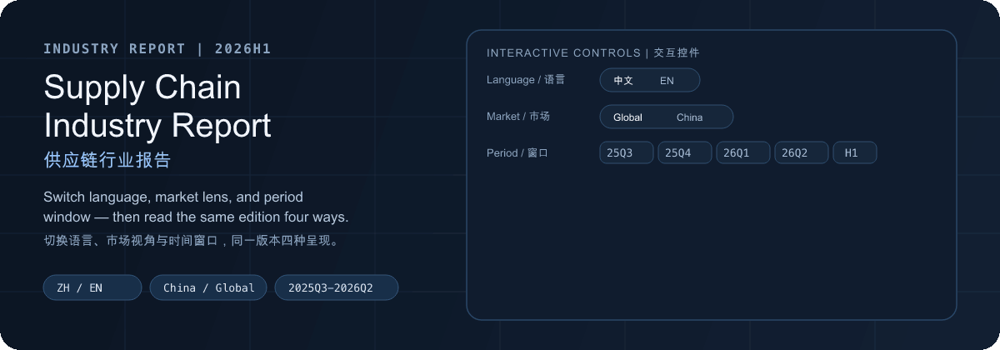
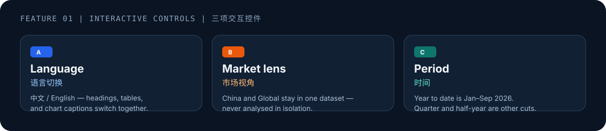
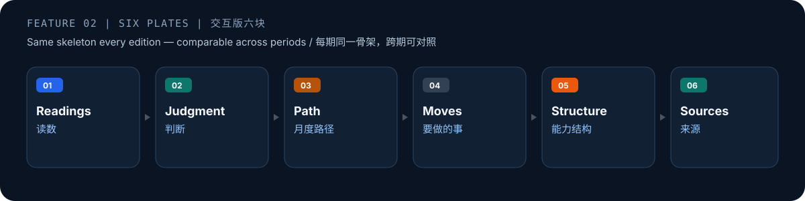
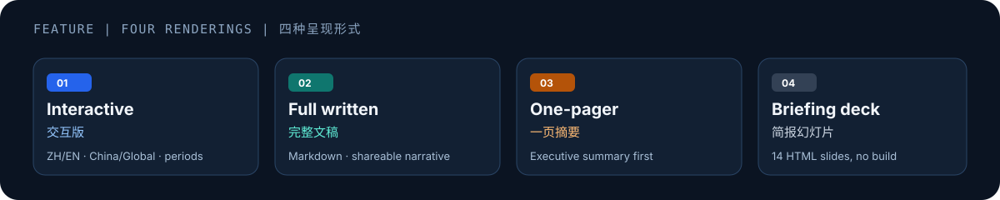
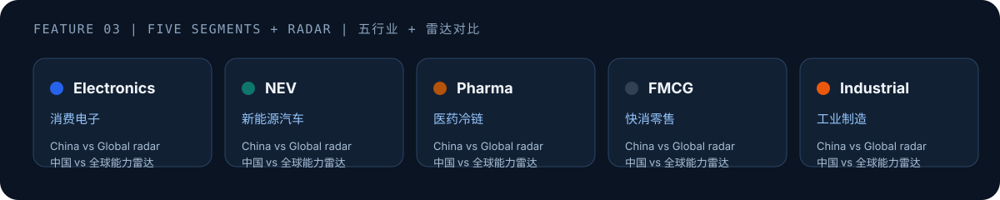

<div align="center">



# Supply Chain Industry Report
# 供应链行业报告

**EN:** A bilingual research workspace for recurring supply chain industry analysis — compare China and Global conditions across quarterly and half-year windows.

**中文：**面向供应链行业的双语研究工作区，按季度 / 半年度窗口复盘，并同时提供中国与全球两种市场视角。

<p>
  <a href="#english">English</a> · <a href="#中文">中文</a>
  ·
  <a href="assets/readme/preview.html">Open animated preview / 打开动效预览</a>
</p>

<p>
  
  
  
  
  
</p>

</div>

---

<a id="english"></a>

# English

## Features at a Glance

The interactive edition is built around three controls, then rendered four ways:










## Read the Report

Current edition: **2026H1**

| Edition | File | Best for |
|---|---|---|
| **Interactive** (中文 / EN) | [`reports/2026H1/report.canvas.tsx`](reports/2026H1/report.canvas.tsx) | Switching language, market view, and period window live |
| **Full written** (中文) | [`reports/2026H1/report.zh.md`](reports/2026H1/report.zh.md) | Reading end to end, quoting, reviewing |
| **One-pager** (中文) | [`reports/2026H1/one-pager.zh.md`](reports/2026H1/one-pager.zh.md) | Forwarding the conclusion to an executive |
| **Briefing deck** (中文) | [`reports/2026H1/slides.zh.html`](reports/2026H1/slides.zh.html) | Presenting — self-contained HTML, no build step |

```bash
open reports/2026H1/slides.zh.html
```

Edition index: [`reports/2026H1/`](reports/2026H1/)

## What This Is

A recurring **decision-support** industry report, not a one-off write-up.

Every edition answers the same five questions — what changed, how the market performed, what everyone is arguing about, where things are heading, and what to do next — so `2026Q1` and `2026Q2` can be read side by side without re-learning the layout.

| | |
|---|---|
| **Scope** | Global supply chain conditions with a dedicated China lens |
| **Windows** | Quarterly (`2025Q3` → `2026Q2`) and half-year (`2025H2`, `2026H1`) |
| **Modes** | Chinese / English · China market / Global market |
| **Indicators** | GSCPI, SCFI, Drewry WCI, China LPI, WTO trade outlook |
| **Audience** | Strategy, operations leadership, procurement, market intelligence |

## Getting Started

```bash
# briefing deck — no tooling
open reports/2026H1/slides.zh.html

# interactive edition — Cursor only detects canvases in its managed folder
cp reports/2026H1/report.canvas.tsx ~/.cursor/projects/<your-workspace>/canvases/
```

Cursor supplies the `cursor/canvas` types at runtime, so there is no dependency install.

## Data & Method Notes

- Built from public references: WTO trade outlooks, New York Fed **GSCPI**, Shanghai Shipping Exchange **SCFI**, Drewry **WCI**, and China Federation of Logistics & Purchasing **LPI** releases.
- Archive windows may use a labelled **trend-score proxy view (baseline = 100)** when a continuous monthly series is unavailable.
- Positioning: a decision-support analysis product, not a statutory disclosure dataset. Re-verify figures before external publication.

## Repository Layout

```text
.
├── README.md
├── reports/2026H1/
├── assets/readme/
│   ├── hero.gif             # animated hero (GitHub playback)
│   ├── hero.svg             # editable static source / fallback
│   ├── hero-motion.json
│   ├── preview.html         # local animated preview page
│   ├── controls.svg         # language / market / period
│   ├── narrative.svg        # seven-section story spine
│   ├── formats.svg          # four edition formats
│   ├── segments.svg         # five industry segments
│   ├── dual-lens.svg        # China / Global radar legend
│   └── made-with.svg        # README design credit badge
├── scripts/
├── CREDITS.md
├── LICENSE.md                 # dual-license overview
├── LICENSE-CODE-MIT
└── LICENSE-CONTENT-CC-BY-4.0
```

## Security

```bash
./scripts/security-scan.sh
./scripts/install-hooks.sh
./scripts/security-scan.sh --self-test
```

If a key is ever exposed, rotate it immediately — deleting it from a later commit does not remove it from history.

## Roadmap

- [ ] Per-period snapshots under `reports/2026Q1`, `reports/2026Q2`, …
- [ ] Standalone Semiconductor segment tab
- [ ] Period-over-period delta panels
- [ ] Chart exports sized for slide decks
- [ ] CI secret scanning on pull requests

## Credits

Tools and references used to build this project — full list in [`CREDITS.md`](CREDITS.md).

| | |
|---|---|
| **README design** | [beautify-github-readme](https://github.com/oil-oil/beautify-github-readme) by oil-oil (MIT) — visual system, hero direction, and motion workflow for `assets/readme/` |
| **Authoring runtime** | [Cursor](https://cursor.com) — Agent workflow and interactive Canvas (`cursor/canvas`) |
| **Research tooling** | AnySearch skill — used while gathering source material for early drafts |
| **Public indicators** | New York Fed GSCPI · WTO trade outlook · Shanghai Shipping Exchange SCFI · Drewry WCI · CFLP LPI |
| **Engineering** | ripgrep · FFmpeg · resvg · Pillow |

<p>
  <a href="https://github.com/oil-oil/beautify-github-readme">
    
  </a>
</p>

## License

This repository is **dual-licensed**. See [`LICENSE.md`](LICENSE.md) for the overview.

| Content | License | File |
|---|---|---|
| Code and scripts | **MIT** | [`LICENSE-CODE-MIT`](LICENSE-CODE-MIT) |
| Report content, documentation, and visuals | **CC BY 4.0** | [`LICENSE-CONTENT-CC-BY-4.0`](LICENSE-CONTENT-CC-BY-4.0) |

Copyright (c) 2026 SummerPapaya

When reusing the report content or visuals, attribute SummerPapaya and link to CC BY 4.0.

---

<a id="中文"></a>

# 中文

## 功能一览

交互版围绕三项控件展开，再以四种形式输出：


## 阅读报告

当前版本：**2026H1**

| 版本 | 文件 | 适用场景 |
|---|---|---|
| **交互版**（中文 / EN） | [`reports/2026H1/report.canvas.tsx`](reports/2026H1/report.canvas.tsx) | 实时切换语言、市场视角与时间窗口 |
| **完整文稿**（中文） | [`reports/2026H1/report.zh.md`](reports/2026H1/report.zh.md) | 通读、引用、审阅 |
| **一页摘要**（中文） | [`reports/2026H1/one-pager.zh.md`](reports/2026H1/one-pager.zh.md) | 向管理层快速传递结论 |
| **简报幻灯片**（中文） | [`reports/2026H1/slides.zh.html`](reports/2026H1/slides.zh.html) | 汇报演示 — 纯 HTML，无需构建 |

```bash
open reports/2026H1/slides.zh.html
```

版本目录：[`reports/2026H1/`](reports/2026H1/)

## 这是什么

这是一份可复用的**决策支持型**行业报告，而不是一次性文稿。

每一期都回答同样五个问题 — 发生了什么、市场表现如何、当下焦点议题、趋势走向、以及下一步动作 — 因此 `2026Q1` 与 `2026Q2` 可以并排阅读，无需重新熟悉结构。

| | |
|---|---|
| **覆盖范围** | 全球供应链格局，并设中国市场专章视角 |
| **时间窗口** | 季度（`2025Q3` → `2026Q2`）与半年度（`2025H2`、`2026H1`） |
| **阅读模式** | 中文 / 英文 · 中国市场 / 全球市场 |
| **核心指标** | GSCPI、SCFI、Drewry WCI、中国 LPI、WTO 贸易展望 |
| **主要读者** | 战略、运营管理、采购、市场情报团队 |

## 快速开始

```bash
# 简报幻灯片 — 无需额外工具
open reports/2026H1/slides.zh.html

# 交互版 — Cursor 仅识别其托管的 canvases 目录
cp reports/2026H1/report.canvas.tsx ~/.cursor/projects/<your-workspace>/canvases/
```

Cursor 运行时提供 `cursor/canvas` 类型，无需安装依赖。

## 数据与方法说明

- 基于公开资料：WTO 贸易展望、纽约联储 **GSCPI**、上海航运交易所 **SCFI**、Drewry **WCI**、中国物流与采购联合会 **LPI** 发布。
- 历史窗口在缺少连续月度序列时，可能使用标注的**趋势得分代理视图（基线 = 100）**。
- 定位：决策支持分析产品，而非法定披露数据。对外发布前请复核数字。

## 仓库结构

```text
.
├── README.md
├── reports/2026H1/
├── assets/readme/
│   ├── hero.gif             # 动效头图（GitHub 可播放）
│   ├── hero.svg             # 可编辑静态源 / 回退
│   ├── hero-motion.json
│   ├── preview.html         # 本地动效预览页
│   ├── controls.svg         # 语言 / 市场 / 窗口
│   ├── narrative.svg        # 七段叙事骨架
│   ├── formats.svg          # 四种呈现形式
│   ├── segments.svg         # 五个细分行业
│   ├── dual-lens.svg        # 中国 / 全球雷达图例
│   └── made-with.svg        # README 设计致谢徽章
├── scripts/
├── CREDITS.md
├── LICENSE.md                 # 双重许可总览
├── LICENSE-CODE-MIT
└── LICENSE-CONTENT-CC-BY-4.0
```

## 安全

```bash
./scripts/security-scan.sh
./scripts/install-hooks.sh
./scripts/security-scan.sh --self-test
```

若密钥曾暴露，请立即轮换 — 从后续提交中删除并不能清除历史记录。

## 路线图

- [ ] 按期快照：`reports/2026Q1`、`reports/2026Q2` …
- [ ] 独立的半导体细分页签
- [ ] 期与期之间的变化面板
- [ ] 适配幻灯片尺寸的图表导出
- [ ] PR 上的 CI 密钥扫描

## 致谢

构建本项目所使用的工具与资料 — 完整列表见 [`CREDITS.md`](CREDITS.md)。

| | |
|---|---|
| **README 设计** | [beautify-github-readme](https://github.com/oil-oil/beautify-github-readme)（oil-oil，MIT）— 用于 `assets/readme/` 的视觉体系、头图方向与动效流程 |
| **创作运行时** | [Cursor](https://cursor.com) — Agent 工作流与交互 Canvas（`cursor/canvas`） |
| **检索工具** | AnySearch skill — 用于早期文稿的资料检索 |
| **公开指标** | 纽约联储 GSCPI · WTO 贸易展望 · 上海航运交易所 SCFI · Drewry WCI · 中物联 LPI |
| **工程工具** | ripgrep · FFmpeg · resvg · Pillow |

<p>
  <a href="https://github.com/oil-oil/beautify-github-readme">
    
  </a>
</p>

## 许可

本仓库采用**双重许可**。总览见 [`LICENSE.md`](LICENSE.md)。

| 内容 | 许可 | 文件 |
|---|---|---|
| 代码与脚本 | **MIT** | [`LICENSE-CODE-MIT`](LICENSE-CODE-MIT) |
| 报告内容、文档与视觉资产 | **CC BY 4.0** | [`LICENSE-CONTENT-CC-BY-4.0`](LICENSE-CONTENT-CC-BY-4.0) |

Copyright (c) 2026 SummerPapaya

转载或改编报告内容与视觉资产时，请署名 SummerPapaya，并附上 CC BY 4.0 链接。
